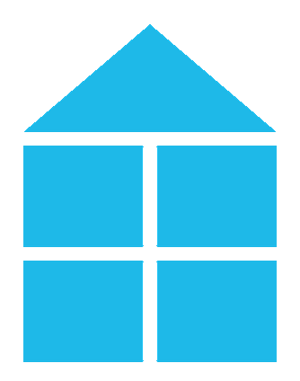
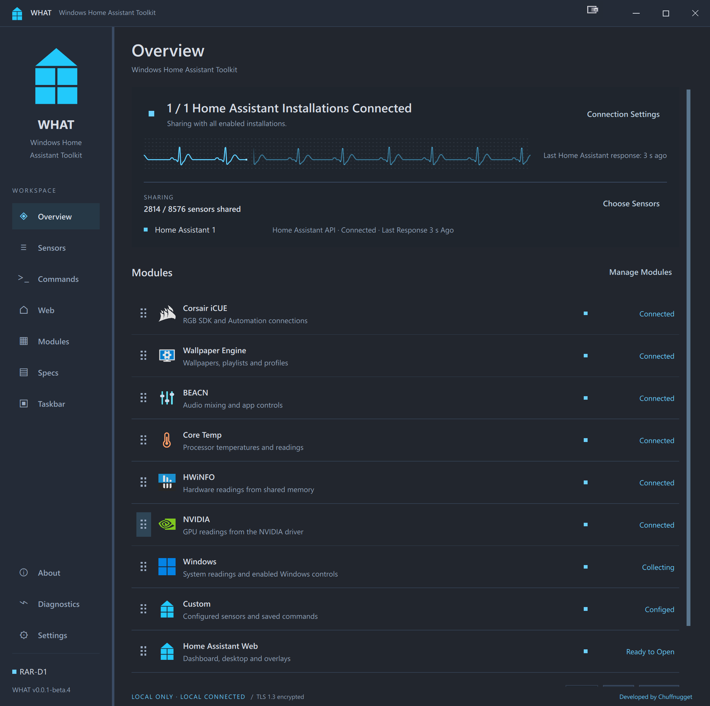

<p align="center">
  
</p>
<h1 align="center">WHAT</h1>
<p align="center"><strong>Windows Home Assistant Toolkit</strong></p>

<p align="center">
  <a href="https://github.com/Chuffnugget/what-windows/releases">
    
  </a>
  <a href="https://github.com/Chuffnugget/what-windows/actions/workflows/windows-release.yml">
    
  </a>
  <a href="https://github.com/Chuffnugget/what-windows/releases">
    
  </a>
  <a href="LICENSE">
    
  </a>
</p>
<p align="center">
  <a href="https://www.paypal.me/chuffnugget">
    
  </a>
  <a href="https://coff.ee/chuffnugget">
    
  </a>
</p>

WHAT (Windows Home Assistant Toolkit) connects Windows PCs to Home Assistant for
monitoring and control. It supports Windows APIs for audio, media, displays,
notifications and Dynamic Lighting; HWiNFO and Core Temp shared memory; NVIDIA
NVML; BEACN; Corsair iCUE RGB and Automation; and Wallpaper Engine. Custom sensors,
saved commands and an embedded Home Assistant dashboard are included. Connect
one or more Home Assistant installations through WHAT API or MQTT, and choose
which readings and controls each can access.

[Home Assistant integration](https://github.com/Chuffnugget/what-integration#readme) - install alongside this Windows app.



This repository contains the Windows application. It targets Windows 11 x64 and
native ARM64. ARM64 support is awaiting hardware validation and has a smaller
supported module set. See [building for ARM64](documentation/RELEASE.md#native-windows-arm64).
The companion integration requires Home Assistant 2026.9+.

## Get started

1. Download the Setup EXE from [Windows releases](https://github.com/Chuffnugget/what-windows/releases),
   install it and open WHAT. The installed edition supports notification collection
   and automatic update installation. For portable use, extract the complete
   portable ZIP and run `WHAT.exe`.
2. Install the [Home Assistant integration](https://github.com/Chuffnugget/what-integration#readme).
3. In WHAT, open **Overview > Pair This PC** or **Settings > Home Assistant
   Installations**. Add or select an installation, choose **WHAT API (Recommended)**
   or **MQTT**, and open its **Pairing** details.
4. In Home Assistant, open **Settings > Devices & services** and configure the
   discovered PC, or choose **Add integration > WHAT**. Match the connection method
   and copy the details shown in WHAT. WHAT API supports local and remote access;
   MQTT uses your configured broker. Keep the private certificate key on the PC.
5. Enable the modules you need, select readings in the sensor browser, and enable
   any required control permissions.

Discovery uses local mDNS/Zeroconf. Use manual pairing when multicast is blocked
by a firewall, router or VLAN. The integration requires Home Assistant 2026.9+.

## Multiple Home Assistant Installations

Use **WHAT > Settings > Home Assistant Installations** to add, name, edit,
enable, disable or delete API and MQTT connections. Each has separate pairing
details and connects independently. Select the matching installation before
copying its token. Remote API and MQTT pairing can be completed without direct
PC access. See [remote API setup](documentation/REMOTE.md) and
[MQTT setup](documentation/MQTT.md).

## Modules

| Module | Readings and controls |
| --- | --- |
| Windows | System sensors, security status, audio, media, displays, notifications, Dynamic Lighting and optional PC actions |
| HWiNFO | Hardware readings exposed through HWiNFO shared memory |
| Core Temp | Per-core and highest core temperatures, per-core load, clocks and supported voltage/power readings |
| NVIDIA | GPU telemetry through NVML, supplied by supported NVIDIA drivers |
| BEACN | Supported mixer and application controls |
| iCUE RGB | Supported RGB devices and individual LEDs through the iCUE SDK |
| iCUE Automation | Supported profile, device and Lighting Link controls |
| Wallpaper Engine | Playback, wallpapers, playlists, profiles and wallpaper properties |
| Custom | Process, service, file, counter, WMI and script readings, plus named command buttons |
| Home Assistant Web | Embedded dashboard, desktop/fullscreen/PiP views, hotkey, per-view dashboards, monitor selection, cloud fallback, recovery, audio and site permissions |

Features depend on hardware, installed software and permissions. Module settings
configure discovery, connections and permissions. Use the sensor browser and Home
Assistant for readings and actions.

Core Temp and HWiNFO are separate monitoring applications. Disabling a WHAT module
does not stop its source application. Core Temp temperatures are normalised to
Celsius; distance to TjMax is a separately named reading. **Highest Core Temperature**
reports the hottest valid core in each CPU's current sample, including when Core
Temp uses distance-to-TjMax mode. See the module guides below for prerequisites and limits.

## Connections and sharing

The recommended WHAT API connection uses authenticated TLS WebSockets. Optional remote
access uses your Home Assistant HTTPS address, including Nabu Casa. Both ends
must permit remote access.

MQTT uses your broker and HA's MQTT integration. Configure it under
**Settings > Home Assistant Installations**. Keep the existing WHAT integration entry when switching
transports so entity IDs and history remain associated with the PC.

Each reading has Local and Cloud sharing choices. Fast updates selects the faster
publishing interval; it does not increase a source application's hardware polling
rate. Module permissions also control which actions HA may perform.

## Taskbar and system tray

Open **Taskbar** in the sidebar or tray menu. The first two entries are
**WHAT app icon** and **WHAT system tray icon**. Each can use the WHAT logo, a
custom image or a sensor reading. Use **Restore WHAT logo** to reset either one.
Changing the app icon affects the running window, not installed or pinned shortcuts.

**Add system tray** creates extra readings beside the clock. Select several
readings at once, or right-click a sensor in the browser and choose
**Add to system tray**. Each icon shows a compact value, with the full reading
and units in its tooltip. Windows may initially put new icons in the overflow.

**Add app icon** creates a separate taskbar button. Clicking it opens WHAT's
Taskbar page. These buttons exist while WHAT is running and cannot be pinned as
independent applications.

WHAT supports 32 extra tray icons and 16 extra taskbar icons. Sensor icons have
font, text colour and background opacity controls. Settings and custom images
are saved across restarts. Unavailable readings show a dash instead of a stale
value. Icons are local to this PC and do not select readings for HA.

## Startup, updates and backup

Under **Settings > Startup**, choose whether WHAT starts at Windows sign-in,
starts minimised, and shows a brief startup notice. Closing the window hides it
to the tray; **Quit WHAT** exits it. Tray connection actions follow the selected
HA API or MQTT transport.

Use **Settings > Application updates** to check releases. Beta updates are off
by default. **Choose release** supports upgrades and confirmed downgrades.
Installation requires the packaged edition; portable and Qt Creator builds can
check releases. See [Release and update details](documentation/RELEASE.md).

Use **Settings > Configuration backup** to preview, export or import settings.
The export excludes passwords and pairing identity. Imports apply on the next
start. Back up the full profile before downgrading. See
[Configuration backup](documentation/CONFIGURATION.md).

## Diagnostics

Activity Log, Live Diagnostics and Logging and Crash Reports open as collapsible
sections. The open log uses the available reading space. Collapsed views stop
formatting text; collection continues. Pause or select text to hold a snapshot.

The Diagnostics page can prepare a report for review, copying or saving. Optional
local logging records redacted activity, version/health snapshots and native crash
reports. Memory dumps are a separate opt-in and can contain private data.
Nothing is uploaded automatically. See [Diagnostics](documentation/DIAGNOSTICS.md) for
file limits, redaction and crash-report limitations.

The Specs page collects a cached hardware summary in the background. It includes
GPU memory and type, RAM slots and transfer rates, drive media and bus types,
Windows feature version and build revision, display scaling/HDR/colour depth,
network link speeds, BIOS/boot/Secure Boot/TPM details and battery capacities
when present. Refresh shows progress and the last collection time. Fields that
Windows or the driver cannot provide are marked unavailable. The report excludes
serial numbers, account names and network addresses.

## Build from source

Use Qt 6.11.2 MSVC2022 64-bit with Visual Studio 2022 17.14+ or Visual Studio 2026.
The app and Windows helper use MSVC. The build also needs the Windows SDK,
OpenSSL and native Windows Python 3.12+.

```bat
scripts\Build-Release.cmd
```

Run this from the Windows repository. It builds and tests the app and Windows
helper, then prepares a portable runtime. No signing identity is needed. To run it
from PowerShell after a successful build:

```powershell
$build = Get-Content ./build/latest-release.json -Raw | ConvertFrom-Json
& (Join-Path $build.runtime 'WHAT.exe')
```

The checkout can live in any directory. Tool locations are detected or configured
in the ignored `release.local.json`; relative paths in that file start at this
repository. The first build downloads dependencies. See the
[release guide](documentation/RELEASE.md) for prerequisites and Qt Creator setup.
`Build-All.cmd` builds x64 and ARM64 and requires a signing identity. On x64 it
creates signed installers for both architectures. x64 runs its runtime tests;
ARM64 is cross-compiled and packaged with runtime testing marked as pending.
Use `Build-All.cmd -Architecture x64` for x64 only. Each run saves a compilation
summary to `build/compilation-report.md`, including errors, warnings, stage timings,
output paths and runtime-test status. Full logs and previous reports are retained.

The C++ style is defined in `.clang-format`. QML uses Qt's formatter with four-space
indentation. Keep one statement per line and explain ownership or ordering where
it is not obvious from the code.

## Source layout

`qml/Main.qml` owns the window and connects pages and prompts. The UI is split into:

- `qml/pages/`: one file per sidebar page, including `TaskbarPage.qml` for both kinds of icon.
- `qml/modules/`: each module's settings, plus module status and polling helpers.
- `qml/controls/`: shared buttons, fields, checkboxes, sections, scrolling and `Theme.qml`.
- `qml/dialogs/`: application prompts, each with explicit inputs and action signals.
- `qml/components/`: larger reusable pieces such as navigation, device controls and visual effects.

Pages receive their controller and other inputs through properties. They emit signals
for navigation and prompts instead of reaching into another file's IDs. `ModuleSection.qml`
is a toggleable settings subsection used by Windows and iCUE; `WindowsSettings.qml`
contains the Windows module's settings. `WHAT_QML_FILES` in CMake lists resources once
for both the app and its UI tests.

GUI colours, text sizes, spacing and control heights come from `Theme.qml`.
Use the shared controls instead of styling a Qt control again inside a page.
Controls have square corners, with 36 px standard and 28 px compact heights.
Use the compact variants in dense lists. Lists and sections use separators;
inputs and popups have outlines. Keyboard focus uses `visualFocus` so mouse
clicks do not leave a focus border. `GlassDialog` supplies the common prompt
header, glass background and backdrop, with `PromptButtons`
for standard dialog actions. Pass the window's content surface as `backdropSource`.
Keep new modal prompts in `Main.qml`'s `webModalOpen` binding so the native
WebView2 surface stays hidden while a prompt covers it.
Keep row delegates light: no per-row blur, shadow or layer effects.

C++ headers describe threading, ownership and asynchronous completion where callers
need to know them. Comments inside methods explain required ordering and reasons for
guards. Simple getters and setters do not need comments that repeat their names.

## Guides

- [User guide](documentation/USER-GUIDE.md), [Installation](documentation/INSTALLATION.md)
- [Remote access](documentation/REMOTE.md), [MQTT](documentation/MQTT.md), [Protocol](documentation/PROTOCOL.md)
- [Displays](documentation/DISPLAYS.md), [NVIDIA](documentation/NVIDIA.md), [BEACN](documentation/BEACN.md)
- [iCUE](documentation/ICUE.md), [Dynamic Lighting](documentation/DYNAMIC-LIGHTING.md), [Wallpaper Engine](documentation/WALLPAPER_ENGINE.md)
- [Notifications](documentation/NOTIFICATIONS.md), [Input controls](documentation/INPUT.md)
- [Configuration and backup](documentation/CONFIGURATION.md), [Diagnostics](documentation/DIAGNOSTICS.md), [Windows security](documentation/WINDOWS-SECURITY.md)
- [Building and releasing](documentation/RELEASE.md), [Rebuilding libraries](documentation/REBUILDING.md), [Integration contract](documentation/INTEGRATION-CONTRACT.md)
- [WHAT logo](documentation/LOGO-ASSETS.md), [Module artwork](documentation/BRAND-ASSETS.md)
- [Third-party notices](documentation/licenses/THIRD-PARTY.md), [Redistribution notes](documentation/REDISTRIBUTION.md)

## Planned features

Desktop widgets and native controls for Home Assistant entities are planned.
They are not available yet and have no release date. The Home Assistant Web
module already provides access to your dashboard through an embedded browser.

## Licence

WHAT is [LGPL-3.0-or-later](LICENSE), as declared in [COPYRIGHT](COPYRIGHT).
[COPYING.GPL-3.0](COPYING.GPL-3.0) supplies the GPL terms incorporated by LGPL v3.
Third-party software and artwork retain their own terms; see [component notices](documentation/licenses/THIRD-PARTY.md) and
[artwork sources](documentation/BRAND-ASSETS.md).

WHAT is an independent project. It is not affiliated with or endorsed by Microsoft,
NVIDIA, HWiNFO/REALiX, Corsair, BEACN, the Wallpaper Engine developers or Home
Assistant. Product names and logos belong to their respective owners.
